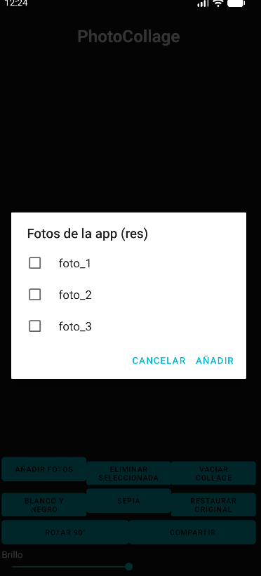
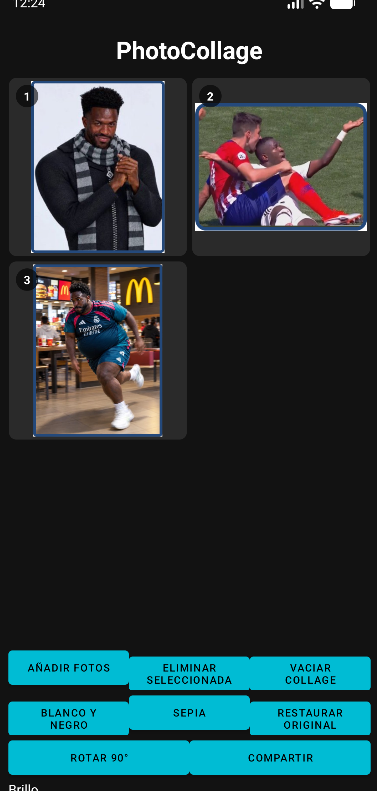
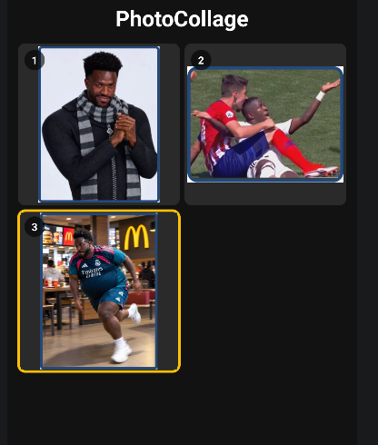
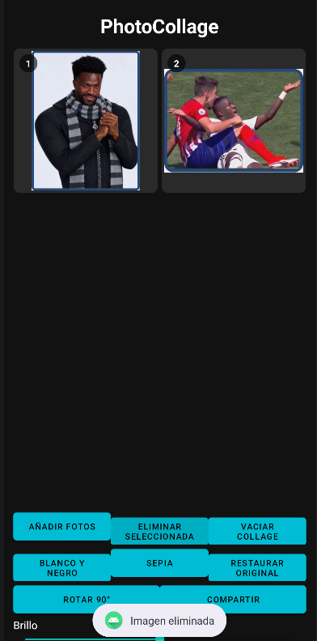
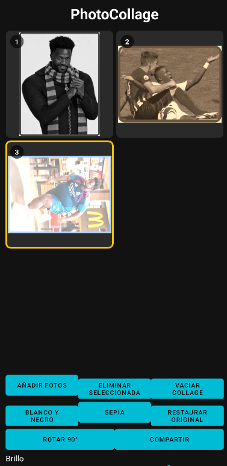
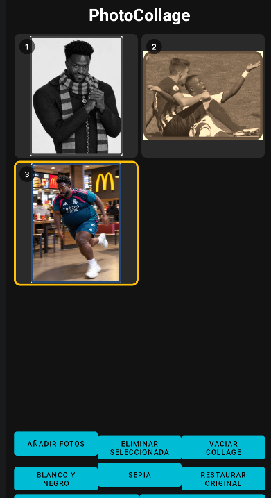
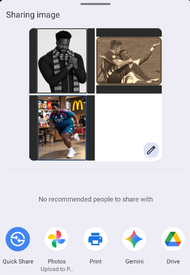

# Examen Android Studio
Aplicación Android desarrollada en **Kotlin** con **Android Studio** que permite crear un collage
con fotografías y aplicarles distintas operaciones de edición.
Proyecto del examen práctico de 2.º DAM.

## Funcionalidades

- **Añadir fotos**: se pueden elegir varias fotos a la vez.
  - Si hay fotos `foto_...` en `res/drawable`, se muestra una lista con casillas para elegir cuáles añadir.
  - Si no hay ninguna, se abre el selector de fotos (Photo Picker) de la galería del dispositivo.
  - No se permite añadir la misma foto dos veces. Si el collage está vacío se muestra un mensaje.
- **Collage en cuadrícula** (`RecyclerView` + `GridLayoutManager`): celdas cuadradas, fotos sin deformar,
  número identificativo en cada foto y columnas adaptadas al tamaño de pantalla (con layout propio en horizontal).
- **Seleccionar** una foto (se resalta con un borde amarillo) y **eliminarla**.
- **Vaciar collage** con confirmación mediante `AlertDialog`.
- **Filtros** programados en Kotlin con `ColorMatrix`: blanco y negro y sepia.
- **Restaurar original**: devuelve la foto seleccionada a su estado inicial (filtro, rotación y brillo).
- **Rotar** la foto seleccionada 90° en sentido horario en cada pulsación.
- **Brillo** ajustable con un `SeekBar` en tiempo real (la posición central es el brillo original).
- **Compartir** el collage como imagen PNG mediante `Intent` y `FileProvider`.
- El estado de las fotos y sus ediciones se mantiene al girar el dispositivo (`ViewModel`).

## Estructura del proyecto

```
app/src/main/java/com/example/collageapp/
├── MainActivity.kt               # Interfaz y eventos
├── adapter/CollageAdapter.kt     # Adaptador del RecyclerView
├── model/CollageImage.kt         # Modelo de foto (original + versión editada)
├── utils/ImageUtils.kt           # Carga, filtros, rotación, brillo y generación del collage
└── viewmodel/CollageViewModel.kt # Estado y lógica de edición
```

## Cómo ejecutar el proyecto

1. Clonar el repositorio y abrir la carpeta del proyecto con **Android Studio**
   (*File → Open* y elegir la carpeta que contiene `settings.gradle.kts`).
2. Esperar a que termine la sincronización de Gradle (requiere conexión a internet).
3. Seleccionar un emulador o un móvil con Android 7.0 (API 24) o superior.
4. Pulsar **Run ▶**.
5. Para probar la app:
   - Fotos de ejemplo: están en `app/src/main/res/drawable` con nombre `foto_1`, `foto_2`, etc.
     Se pueden añadir más copiándolas ahí con el prefijo `foto_`.
   - Fotos de la galería: si no hay fotos `foto_...` en `res/drawable`, se abre la galería.
     En el emulador basta con arrastrar imágenes a su ventana para guardarlas.
## Capturas de pantalla

### Añadir fotos
| Selección de fotos | Fotos añadidas al collage |
|---|---|
|  |  |

### Seleccionar y eliminar
| Foto seleccionada | Eliminar |
|---|---|
|  |  |

### Edición
| Filtros, rotación y brillo | Restaurar original |
|---|---|
|  |  |

### Compartir

